<p align="center">
  
</p>

<h1 align="center">Claude Skills</h1>
<p align="center"><b>385 skills that turn your AI assistant into a specialist: board prep, product planning, compliance audits, code review, marketing and the rest of the business.</b></p>

<p align="center">
  <a href="https://github.com/borghei/Claude-Skills/stargazers"></a>
  <a href="https://github.com/borghei/Claude-Skills/tags"></a>
  <a href="LICENSE"></a>
  
</p>
<p align="center">
  
  
  
  
  
</p>

## Add it to your assistant

Pick the place you already work. The first two need no terminal.

| Where you work | How to add it |
|---|---|
| **Claude desktop app** | Open **Customize** (bottom-left) → **Browse plugins** → enter `borghei/Claude-Skills`. Every skill is then available in your conversations. |
| **Claude.ai, ChatGPT or Gemini in the browser** | Open the [skill library](https://borghei.github.io/Claude-Skills), pick a skill and click **Try it now** to copy its prompt, or **Save to my AI** to keep it as a Claude Project or Custom GPT. |
| **Claude Code** | `/plugin marketplace add borghei/Claude-Skills`, then install the set you need, e.g. `/plugin install c-level-skills@claude-code-skills` |
| **Cursor, Codex, Gemini CLI, Copilot, Windsurf, Cline, Goose, Aider** | `npx @borghei/claude-skills add board-deck-builder` puts one skill in the right folder for your assistant. Find skills with `npx @borghei/claude-skills search "board"`. Needs Node 18+. |

Manual install, the MCP server and per-tool details: [docs/INSTALLATION.md](docs/INSTALLATION.md).

## See one run

A founder with a board meeting on Thursday asks:

> *"Board meeting Thursday. Here are this quarter's numbers. Build the metrics page and tell me what the board will push on."*

The `board-deck-builder` skill first asks the questions that change the deck: which kind of meeting this is, what the headline is, and what you need the board to decide. Then it runs its own tool on your numbers:

```text
$ python3 scripts/metrics_dashboard_generator.py --input q3-metrics.json

KEY METRICS DASHBOARD
Summary: 7G / 1Y / 0R

Metric             Actual     Target       Prev    Var%  RAG Trend  Owner
ARR                 $2.4M      $2.3M      $2.0M   +4.3%  [G] Up     CRO
Burn Multiple        1.8x       2.0x       2.1x  -10.0%  [G] Down   CFO
NRR                112.0%     110.0%     108.0%   +1.8%  [G] Up     CRO
CAC Payback         11 mo      12 mo      14 mo   -8.3%  [G] Down   CMO
Runway              16 mo      18 mo      19 mo  -11.1%  [Y] Down   CFO
...
```

Runway is the one yellow, so that's where the board will push. The skill frames it with its bad-news structure (state it, own it, show you understand it, present the fix) and drafts the deck section by section, from the executive summary to the asks. The numbers come from the tool, not the model, so they are the same every time you run it.

## Pick your starting point

In the Claude desktop app everything is already included; just ask. In Claude Code, add the set that matches the work:

| What you want to do | Add | Try asking |
|---|---|---|
| Prepare a board meeting, investor update or strategy call | `c-level-skills` | "Build the metrics page for Thursday's board meeting" |
| Plan and ship product work: specs, priorities, roadmaps, sprints | `pm-skills` | "Write a PRD for bulk export, then RICE-score these five requests" |
| Get ready for an audit: SOC 2, ISO 27001, GDPR, EU AI Act | `ra-qm-skills` | "Where are we short for SOC 2 Type II?" |
| Review and ship code | `engineering-advanced-skills` | "Review this PR and tell me what else it could break" |
| Grow traffic and sign-ups | `marketings` | "Audit this landing page for AI search" |
| Keep customers and close deals | `business-growth-skills` | "Design a cancel flow with save offers" |

Install any of them with `/plugin install <name>@claude-code-skills`.

## What's inside

**Leadership and business:** [C-Level Advisory (31)](c-level-advisor/) · [Business & Growth (20)](business-growth/) · [Business Operations (6)](business-operations/) · [Finance (3)](finance/) · [Sales (5)](sales-success/) · [HR (4)](hr-operations/) · [Vertical Advisors (7)](vertical-advisors/)

**Product and engineering:** [Project Management (70)](project-management/) · [Product Team (13)](product-team/) · [Engineering (92)](engineering/) · [Data (6)](data-analytics/)

**Compliance and legal:** [Compliance & Quality (27)](ra-qm-team/) · [Legal (17)](legal/)

**Content and everyday work:** [Marketing (41)](marketing/) · [LinkedIn tools (12)](tools/) · [Personal Productivity (13)](personal-productivity/) · [Documents (4)](documents/) · [Markdown to HTML (4)](markdown-html/) · [Research (4)](research/) · [Research Ops (4)](research-ops/) · [Workflow (2)](workflow/)

[Every skill, with descriptions →](https://borghei.github.io/Claude-Skills/skills/)

What sets it apart:

- **Regulated work, not just code.** SOC 2, ISO 13485, MDR, FDA, EU AI Act, NIS2, DORA, HIPAA and GDPR, with gap analyses and audit-ready output.
- **Tools that compute.** 906 Python tools do the scoring, sizing and checking, using only the standard library, so you can also run them in CI.
- **Asks before it writes.** Skills that produce a deliverable confirm the two or three inputs that change it, so you don't get a polished document built on a guess.

## More ways to use it

- **Personas** combine several domains into one expert: `startup-cto`, `solo-founder`, `product-manager`, `growth-marketer`, `finance-lead`, `content-strategist`, `devops-engineer`, `skill-creator`. Use `/persona startup-cto` or name one in your request.
- **68 single-domain agents** such as `cs-cto-advisor`, `cs-fintech-advisor` and `cs-security-auditor` go deeper on one area.
- **26 slash commands** for common jobs: `/prd`, `/rice`, `/retro`, `/sprint-plan`, `/tech-debt`, `/security-scan`, `/changelog` and more. See [docs/commands/](docs/commands/).

Docs: [website](https://borghei.github.io/Claude-Skills) · [skills reference](docs/skills-reference.md) · [agents reference](docs/agents-reference.md) · [usage guide](docs/USAGE.md) · [installation](docs/INSTALLATION.md) · [standards](standards/)

## Contributing

Contributions are welcome. Fork the repo, write a skill that follows the [Skill Authoring Standard](standards/skill-authoring-standard.md), include its Python tools and frontmatter, and open a PR. See [CONTRIBUTING.md](CONTRIBUTING.md).

| Contributor | GitHub |
|-------------|--------|
| Alan Pope | [@popey](https://github.com/popey) |
| Izzy | [@weemax](https://github.com/weemax) |
| Rohan (Tessl) | [@rohan-tessl](https://github.com/rohan-tessl) |

Thanks to [@rishaankgupta](https://github.com/rishaankgupta) for responsibly disclosing a shell-injection vulnerability (CWE-78) in the `claude-code-review.yml` workflow template. The fix hardened every workflow template against the same pattern.

## License

**MIT + Commons Clause.** Free for open-source, personal, education and internal business use. It can't be sold or repackaged as a paid product. See [LICENSE](LICENSE).
